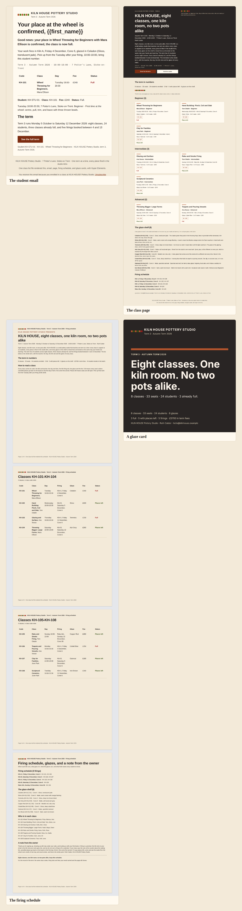
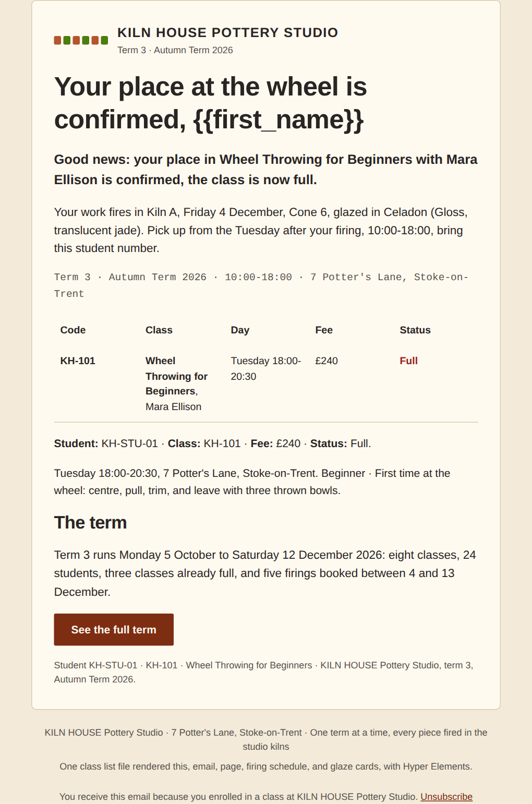
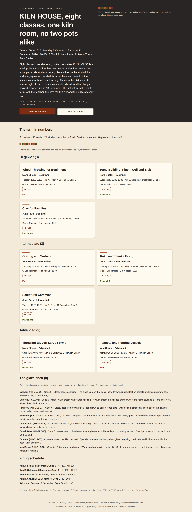
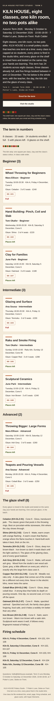
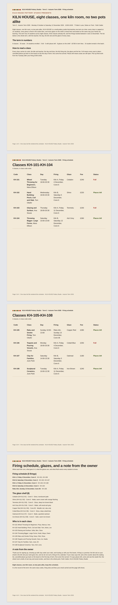
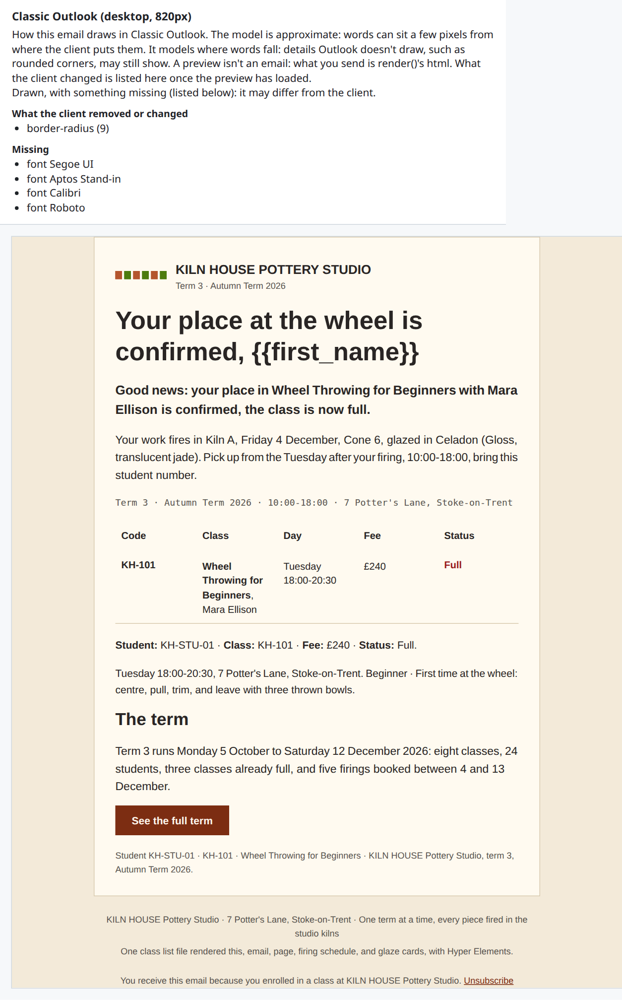
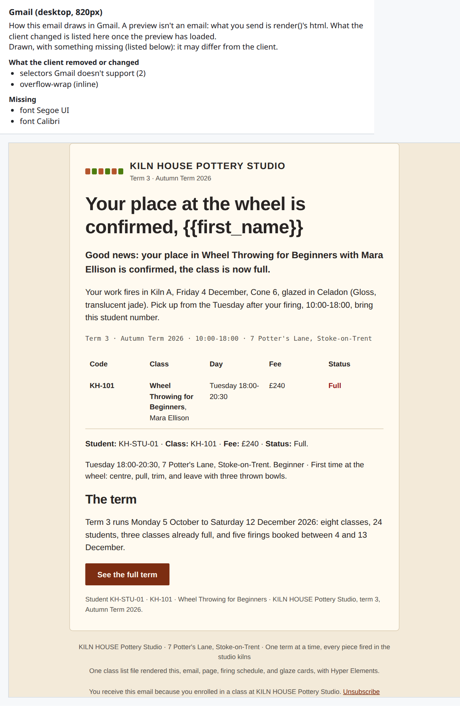

# KILN HOUSE, Eight classes, one kiln room, no two pots alike

A Hyper Elements template kit for a pottery studio's class term.
**One class list file** (`src/data/classes.ts`) renders
everything a pottery term needs, the student email, the public
class page, the printed firing schedule as a real PDF, and the
square glaze cards, from **one theme** and **one set of
shared components**.



*Every screenshot in this README is a photograph of a real render
(`npm run render` + `npm run shots`): if it is pictured, it was rendered.*

**Measured on the demo run (23 Nov 2026):** one class list file →
**24 personalised student emails**, a **4-page firing-schedule
PDF** (one A4 PDF: term cover, two class pages, firing schedule
and the owner's note), **9 glaze cards** (studio cover + one per
glaze) gate at **0 errors, 0 warnings**, batch in **1.6s**.
Reproduce it: `npm run check && npm run make`, then read
`out/checks.json` and `out/batch.json`.

| The email (600px) | The page (desktop) | The page (mobile) |
|---|---|---|
|  |  |  |

| The firing schedule (A4) | The email in Outlook | The email in Gmail |
|---|---|---|
|  |  |  |

The glaze card PNG itself is in
[`examples/glaze-card.png`](examples/glaze-card.png).

## Why a pottery term?

A pottery term's paperwork fails in a predictable way: the email
says one kiln slot, the wall sheet another, and the student's pot
comes out of a third, a different firing, a different glaze, a
class code spelled two ways. This kit makes that impossible by
construction. Every class code, firing slot and glaze lives in
**one class list file**; the email quotes it, the page's cards
carry it, and the printed firing schedule prints it next to the
owner's note. The **KilnStrip**, one square per class, clay and
the class's status colour, is the term drawn as a shelf of pots,
and it is built from `Row`s of fixed-width `Column`s so it
survives in an inbox that blocks images and in a PDF that never
loads one.

## The four outputs

| Output | Root | Script | What it is |
|---|---|---|---|
| Student email | `Email` → `render()` | `templates/student-email.tsx` | The news leads, your place is confirmed, with the day, teacher, kiln firing slot and glaze, a MergeTag greeting, plain-text twin from the same render |
| Class page | `Page` → `render()` | `templates/class-page.tsx` | Dark clay hero, the eight-class kiln strip, every class as a typed `kiln.ClassCard` grouped by level, glaze shelf, firing schedule, phone styles, no client-side JavaScript |
| Firing schedule | `Document` → `renderPdf()` | `templates/firing-document.tsx` | Four A4 pages, the term (numbers, how to read a class), eight classes four to a page, firing schedule, glaze shelf, who is in each class, and the owner's note, `PageHeader`/`PageFooter` with `PageNumber` |
| Glaze cards | `Canvas` → `renderImage()` | `templates/glaze-card.tsx` | 1080×1080 PNGs, the studio cover, plus one card per glaze with a swatch, cone, finish and blurb in poster type |

## Run it

```bash
npm install
npm run check        # validate() gate: core + lint + email-clients -> out/checks.json
npm run render       # one of each output -> out/
npm run clients      # the email as Outlook / Gmail / Apple Mail draw it -> out/clients/
npm run make         # 24 student emails + firing PDF + 9 glaze cards -> out/students/, out/batch.json
npm run make:sample  # 4 emails, for a quick look
npm run shots        # screenshots of the real outputs -> docs/
```

Node 20+. `examples/` holds one artefact of each kind.

## The term

KILN HOUSE Pottery Studio, Term 3, Autumn Term 2026,
Monday 5 October to Saturday 12 December 2026,
10:00-18:00, 7 Potter's Lane, Stoke-on-Trent. Eight classes, 33
seats, 24 students enrolled, 3 full, 5 with places left, 8 glazes
on the shelf, 5 firings booked between 4 and 13 December, £5,700
in term fees. The data file is the whole product: change the
classes, the students, the glazes or the firings, and every output
follows, because every output reads the same file.

## Design

Earthy craft: warm cream paper `#f3ead9`, clay terracotta
`#b4552d` for shapes only, dark terracotta `#7c2d12` for text
accents, ash glaze green `#365314` for places left, mono class
codes. Status colours are dark enough to be text: full red
`#991b1b`, places left green `#365314`. See
[`docs/design.md`](docs/design.md) for the notes and the build
lessons, including the one that cost a card: a strip without an
explicit width takes an equal share of its Row and pushes the
next block to the far side.
